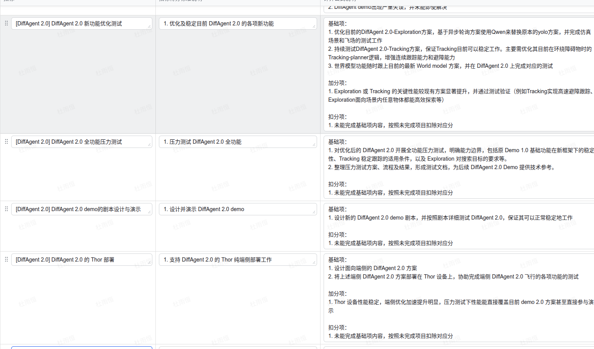

# Auto Research 研究对话记录

本记录包含截至“方法论研究指标优化”回复的用户消息、助手可见回复和原始附件。Codex 原生会话副本同时保留了此前的会话上下文，可在新工作区继续。

- 原会话：`01a1ab5a-5a18-7de2-b3a3-458e56c9c908`
- 副本会话：`01a1ab84-5d5e-71a1-b554-43696abb24e3`
- 副本名称：Auto Research 方法论研究（独立工作区副本）
- 工作目录：`/home/zhywwyzh/workspace/AutoResearch-UAV`

继续会话：

```sh
codex resume 01a1ab84-5d5e-71a1-b554-43696abb24e3 -C /home/zhywwyzh/workspace/AutoResearch-UAV
```

## 1. 用户

时间：2026-11-05T10:56:30.475Z

Auto Research方向探究

现在我想要进行这样的方案研究：我们希望借助目前最先进的ai的帮助，研究一套auto research的论文产出流水线。它需要满足类似如下的功能（从这几个方向探讨，不是要求全部包含）：

1. 能根据最近的某一研究方向的大量顶会论文，包括其自身描述的related work 等内容，去创作类似于综述的论文
2. 能根据某一项我们本身已有的研究成果，结合目前业内的先进研究，对成果提出创新建议，并去创新的、更优的设计方法、研究理论依据与设计实验等
3. 以及其他的在目前的 auto research 领域中的其他研究成果

我该怎么开始这个研究？我此前从未从事过这方面的研究，需要你给出我合理、完善的研究路线，协助我开展auto research方向的学习乃至正式开展一份详细的研究


## 2. 助手

时间：2026-11-05T10:56:36.156Z

我会先梳理 Auto Research 的代表性系统、评测方法和现有局限，再给你一条从入门、复现到开展原创研究的路线。我也会用 canvas 技能整理可浏览的研究路线图，方便后续逐步补充论文和实验结果。


## 3. 助手

时间：2026-11-05T10:56:43.573Z

为了把路线落到你的研究上：你当前关注哪个具体领域、有哪些已有成果或代码，以及大致可用的人员与算力？暂时不确定也可以，我会先按“计算机/机器学习方向、1–2人、小规模可复现实验”给出起步方案。

## 4. 助手

时间：2026-11-05T10:57:23.412Z

目前的证据支持把研究拆成两条线：一条解决“文献是否读全、综述是否有据可查”，另一条解决“提出的改进是否经得起真实实验”。端到端系统已经有成果，但复现和评测研究仍显示，完成若干步骤与产出可靠研究之间有明显差距。我会据此设计起步课题，并区分工程搭建与可能形成论文贡献的部分。


## 5. 助手

时间：2026-11-05T10:58:19.433Z

查到一个会影响选题的重要进展：2026 年的 EPOCH 已经把证据约束、主动反证和独立重跑纳入研究流水线。因此，“给科研 Agent 加审核和反思”本身不足以成为明确的新贡献。更值得验证的问题是：在固定预算下，系统能否识别文献结论的适用条件，并选择真正能区分候选方法的实验。这也更容易与你已有的研究成果衔接。


## 6. 用户

时间：2026-11-05T10:59:02.320Z

问题：为了把路线落到你的研究上：你当前关注哪个具体领域、有哪些已有成果或代码，以及大致可用的人员与算力？暂时不确定也可以，我会先按“计算机/机器学习方向、1–2人、小规模可复现实验”给出起步方案。

回答：我目前主要关注与无人机、agent、探索导航、大模型与具身智能等领域，目前已有工作类似于EGO-Planner，VLN-AN等研究成果。我们的设备有搭载了Orin-NX的四旋翼无人机，需要一定的可复现仿真实验与实机实验，预计的人员参与会视情况而定。我们具备单卡4070Ti SUPER、以及少量的H20 GPU和少量的A100

## 7. 助手

时间：2026-11-05T10:59:15.979Z

这些条件足够把路线收敛到无人机导航与探索。我会把已有规划器和仿真平台作为实验基础，让 AI 负责文献分析、提出改进和运行实验；实机用于验证经过仿真筛选的候选方法。研究重点可以放在“文献中的改进思路，能否在未见场景和 Orin-NX 部署约束下成立”，并同时评估成功率、碰撞、延迟和计算成本。


## 8. 助手

时间：2026-11-05T11:05:04.142Z

路线已经按你的设备和研究方向收敛，写入了[研究路线图](/home/zhywwyzh/.cursor/projects/home-zhywwyzh-workspace-DiffAgent2-Exploration/canvases/auto-research-uav-roadmap.canvas.tsx)。我建议先从纯几何探索切入，再扩展到语义找物和 VLN，这样能分别检验研究流程与导航算法的作用。

你已有的 frontier A/B 文档中，还记录过因控制律差异而撤回比较结果的案例。它很适合用作首批评价任务：测试研究 Agent 能否发现混杂因素、要求重跑，并据此修正结论。


## 9. 助手

时间：2026-11-05T11:08:19.105Z

结合你已有的无人机、规划与具身智能基础，我建议把起点定为：

**构建一套以无人机探索与导航为实验对象的 Auto Research 系统，让它能够从文献和已有系统的失败中提出假设、设计实验、实现改进，并判断改进是否真实成立。**

先完成一个范围明确、可以反复验证的研究闭环，再逐步扩展到综述生成、语义导航和论文撰写。你的领域经验、仿真环境和 Orin-NX 实机，能够为这条路线提供具体的验证条件。

我已经整理了[完整研究路线图](/home/zhywwyzh/.cursor/projects/home-zhywwyzh-workspace-DiffAgent2-Exploration/canvases/auto-research-uav-roadmap.canvas.tsx)，包括 **20 项参考工作、流水线设计、候选课题、评测方案和 16 周计划**。这是可以在聊天旁打开的交互式研究面板，方便后续持续更新，第一周任务也可以逐项勾选。以下解释主要判断和建议。

**首先，要区分“用 AI 做研究”与“研究 Auto Research”。** 两者可以共用基础设施，但论文需要证明的东西不同。

- **用 AI 改进无人机方法：**核心贡献是新的探索、导航或部署方法。需要证明它为什么有效，以及相对已有方法改善了什么。
- **研究 Auto Research 方法：**核心贡献是研究过程本身，例如更准确地提出假设、更有效地选择实验、更少产生错误结论。需要在多个研究任务上证明这种能力。
- **建设内部科研工具：**主要目标是减少人工工作、积累文献和实验资产。很有实用价值，但完成工具不自动意味着具备论文贡献。

我建议你先用一个共同原型支撑这三类目标，在小规模实验后决定第一篇论文的主贡献。

**目前值得学习的工作，可以按四条线阅读。** 以下基于截至 **2026 年 11 月 5 日**的定向检索，属于研究启动材料，尚不是穷尽式系统综述。

- **文献综合与综述生成。** AutoSurvey 已经研究检索、大纲、分节写作和整合；OpenScholar 研究带证据引用的科学问答；SurveyForge 进一步关注大纲、记忆和综述评价。这意味着“收集论文后让模型写综述”已经有直接基线，新的研究需要落到遗漏、引用支持、分类质量或条件理解等具体问题上。[AutoSurvey](https://papers.nips.cc/paper_files/paper/2024/hash/d07a9fc7da2e2ec0574c38d5f504d105-Abstract-Conference.html)、[OpenScholar](https://arxiv.org/abs/2411.14199)、[SurveyForge](https://arxiv.org/abs/2503.04629)。

- **假设生成与科研闭环。** Co-Scientist 采用生成、批评、改进和选择假设的循环；AI Scientist-v2 将假设、代码、实验和论文串联起来。后者的 workshop 评审结果是有意义的进展，但不足以证明系统能够稳定产出主会水平的研究。[Co-Scientist](https://arxiv.org/abs/2502.18864)、[AI Scientist-v2](https://arxiv.org/abs/2504.08066)。

- **受限任务中的自动实验。** `karpathy/autoresearch` 适合学习如何搭建围绕固定任务、训练预算和评价指标的实验循环。这类工程原型很适合入门，但还需要额外解决开放式选题、新颖性和科学解释问题。[官方仓库](https://github.com/karpathy/autoresearch)。

- **评测与证据可靠性。** PaperBench 研究论文复现，AstaBench 强调工具和预算受控的科学任务评测。2026 年的 EPOCH 已经纳入任务契约、主动反证和独立重跑，因此“增加审核、反思、证据链”本身不能直接作为你的创新点。[PaperBench](https://arxiv.org/abs/2504.01848)、[AstaBench](https://arxiv.org/abs/2510.21652)、[EPOCH](https://arxiv.org/abs/2610.06986)。

从这些材料中，我的判断是：**更值得你切入的地方，是文献知识如何转化为在真实约束下成立的实验改进。**

**对于你的第一个目标，建议先做“可核查的专题综述助手”。** 起步主题可以聚焦于“未知环境中的无人机探索”，之后再扩展到语义目标搜索和语言导航。

流程应当是：

**定义范围 → 检索与去重 → 阅读原始证据 → 建立分类 → 比较与综合 → 写作 → 核查。**

这里有三个决定质量的关键。

第一，**Related Work 用于寻找线索，重要判断仍要回到被引论文。** 某篇论文对前人的描述可能简化条件，也可能服务于自身定位。多篇论文重复引用同一结果，也不能算多份独立证据。

第二，每篇论文除了摘要，还要记录：

- 解决什么任务，使用什么输入；
- 假设什么传感器、地图、动力学和计算条件；
- 与哪些基线比较，比较设置是否一致；
- 哪些结论有实验支持，哪些只是解释或展望；
- 失败条件、代码与数据是否可获得。

第三，综述需要形成自己的分析框架。例如按“几何探索—语义搜索—指令导航”、地图表示、决策层级、部署条件和实验真实性分类，解释不同路线为何适合不同问题。**可发表综述的价值通常来自这样的综合判断，而不只是覆盖很多论文。**

初期可以收集约 30–50 篇候选论文，精读其中 20–30 篇，先产出一份短综述。评价重点放在引用是否支持结论、是否遗漏重要路线、是否保留适用条件，而不是文章是否流畅。这里的数量是建议的起步规模。

**对于你的第二个目标，我建议先建立一个很小的“已有成果改进”闭环。** 第一项实验可以只开放 frontier 排序、视点选择或失败恢复中的一个模块，其余模块固定。

例如，系统面对“探索中反复回访、部分房间长期未覆盖”的现象，需要完成：

1. 从日志中确认问题，而非直接接受问题描述。
2. 检索相关方法，并判断其假设是否与你的平台一致。
3. 提出几个竞争性解释。
4. 设计能区分这些解释的最小实验。
5. 修改指定模块、运行实验。
6. 根据结果保留、修正或否定假设。
7. 输出可追溯的实验报告。

一个示例假设是：

> 增加路径重复代价可能减少回访，但也可能使系统过早放弃必须反复接近的狭窄入口。

接下来就不能只找一个表现好的地图，而要在环形走廊、死胡同和遮挡入口等条件下检验，同时保持速度、控制器和传感器一致。这只是说明研究流程的例子，目前没有确认它的新颖性或有效性。

你现有的 [frontier A/B 记录](/home/zhywwyzh/workspace/DiffAgent2-Exploration/doc/iteration/2026-10-26-frontier-full-scene-benchmark.md)提供了很具体的切入点：文档明确撤回了混入控制律差异的比较。可以把这类案例整理为评价任务，测试研究 Agent 是否能够识别混杂、拒绝错误归因，并要求重新实验。

**一个值得正式验证的候选课题是：条件感知的文献综合与预算受限实验选择。** 可以把研究问题表述为：

> 在固定研究预算下，把文献结论的适用条件与候选方案需要接受的反证连接起来，能否提高无人机探索改进在未见场景和端侧约束下的复验成功率？

这个方向与你的资源匹配，但**新颖性仍需进一步核查**。建议拆成两个主要问题，避免一开始承担太多贡献：

- **条件理解是否有用？**普通检索找到了“看起来相关”的方法，条件化检索是否更能找到可迁移到你的传感器、地图、动力学和算力条件中的方法？
- **实验选择是否有用？**面对多个候选解释，系统能否选择成本较低、区分能力较强的实验，从而减少无效搜索？

理论部分可以从“成本约束下的序贯实验选择”入手：已有证据构成状态，候选实验构成行动，实验结果更新不确定性。先做明确、可检验的有限问题，再考虑理论界或保证。模型生成的机制解释、已有定理和新定理证明，应当分别处理。

**系统架构上，要把科研系统与无人机导航系统分开。** 外层科研系统运行在工作站或服务器，负责阅读、规划、编码、运行和分析；内层导航系统运行在仿真或无人机上，是研究对象。

建议的完整流程是：

**研究任务合同 → 文献证据库 → 假设与实验计划 → 受限代码修改 → 仿真执行 → 独立评分 → 留出场景复验 → 端侧验证 → 论文生成。**

其中最重要的基础设施有三项：

- **任务合同：**提前明确可修改模块、预算、成功与失败定义、数据划分和停止规则。
- **实验档案：**保存代码版本、环境、地图、随机种子、配置、原始日志、失败与人工介入。
- **独立评分：**候选生成过程不能随意修改评分器；论文中的数字必须能追溯到运行记录。

初期用明确状态机、结构化文件和数据库即可。是否需要多个 Agent，应通过同预算对照决定。

**评测必须同时回答“研究系统有没有进步”和“无人机有没有进步”。** 这是将原型发展成研究论文的关键。

对于研究系统，建议主要看：

- 固定预算内获得多少个独立复验通过的改进；
- 找到第一个有效改进用了多少资源；
- 把无效改进判断为有效的比例；
- 需要多少人工时间；
- 引用支持、条件理解和假设可实施性。

对于无人机，按任务分别评价：

- 几何探索：固定时间覆盖率、覆盖曲线、T90/T95 达成率、重复路径、碰撞与接管；
- 语义搜索/VLN：任务成功率、错误目标、路径效率、指令完成情况；
- 部署：端到端 p50/p95 延迟、内存、功率模式、超时和降频表现。

没有达到 T90 的实验不能从统计中删除；同一建筑的不同帧不能当作独立场景；搜索时不能反复查看最终测试集。

最低限度应比较**同工具同预算的强单 Agent、适用的常规参数搜索、相关科研流水线和你的方法**。再通过消融判断收益究竟来自条件化证据、实验选择，还是额外模型调用。只有一个候选算法提升，通常还不足以证明研究系统具备普遍优势。

**你的硬件适合这条路线，但应按实验角色分配。**

4070 Ti SUPER 用于开发、仿真和短实验；H20/A100 用于批量实验、较大模型服务以及确有必要的训练；Orin-NX 用于部署测量和硬件在环。准确显存、数量和共享配额尚未明确，因此暂不指定必须运行某个规模的模型。

科研助手初期可以调用可用的前沿模型，同时保留模型替换接口。先用自己的 10–20 个任务比较阅读、编码、实验诊断和成本，再决定选型。科研系统本身不必部署在 Orin-NX 上。

领域基线也要按任务选用：EGO-Planner 对应局部规划，FUEL 对应探索，OpenUAV/UAV-Need-Help 对应更接近语言引导的 UAV 搜索任务，不能直接混为一组比较。[EGO-Planner](https://arxiv.org/abs/2008.08835)、[FUEL](https://github.com/HKUST-Aerial-Robotics/FUEL)、[OpenUAV](https://proceedings.iclr.cc/paper_files/paper/2025/hash/15ce8e7afe5ee95bad56e3b9be28d3d1-Abstract-Conference.html)。

近期部署论文也值得关注，但需要核对证据范围：例如 VLN on the Fly 报告的是使用室内动捕的飞行实验；LightVLN 的 Orin-NX 结果属于硬件在环评价。这些条件会直接影响它们与你的平台是否可比。[VLN on the Fly](https://vln-on-the-fly.github.io/)、[LightVLN](https://arxiv.org/abs/2610.05024)。

**建议按约 16 周推进，人员不足时先收缩到前 8 周。** 以下按约两名主要参与者估算，目标是形成可评价原型和研究证据，不是承诺论文接收。

1. **第 1–2 周：学习与冻结任务。**精读核心论文，建立文献卡；选一个已有探索基线，在少量场景中确认可重复运行。
2. **第 3–4 周：文献助手。**完成带原文证据和适用条件的短综述，对比直接长上下文、普通检索增强和综述流水线。
3. **第 5–6 周：最小研究闭环。**让系统围绕一个失败问题提出假设、修改一个模块、运行仿真并报告结果。
4. **第 7–8 周：选题验证。**做小规模强基线对照和消融，确认是否存在值得继续研究的机制差异。
5. **第 9–12 周：正式仿真实验。**扩展研究任务和场景族，冻结盲测集，完成重复实验、成本统计和失败分析。
6. **第 13–16 周：部署、实机与写作。**先做 Orin-NX 测量和 HIL，再比较预先选定的候选与基线，最后按已核验结果组织论文。

学习内容可以随交付推进：前四周重点补齐检索增强、工具调用、结构化输出和文献评价；随后学习混杂控制、置信区间、序贯实验选择；进入部署阶段再系统整理 sim-to-real 与端侧测量。

**你第一周最值得完成的三个交付物，是一页任务合同、一份核心文献清单和一个可重复的探索基线。** 先选一个具体失败，写出三个可能解释和一个区分它们的实验。这样从第一周开始，学习就在为真实研究积累证据。

本次已经完成公开资料核对和可交互研究方案；尚未运行科研系统、仿真或实机实验。你提到的 **VLN-AN** 尚未确认具体论文或代码版本，正式建立基线时需要与现有成果对齐。

## 10. 用户

时间：2026-11-05T11:08:19.197Z

现在想这次修改迁移到一个workspace下的新的仓库下，不要动我的当前仓库


## 11. 助手

时间：2026-11-05T11:08:23.766Z

我会在 `workspace` 下新建独立的 Auto Research 仓库，把本次研究路线和交互面板迁过去，并核对当前仓库未被改动。


## 12. 助手

时间：2026-11-05T11:11:04.536Z

新仓库已建在 `/home/zhywwyzh/workspace/AutoResearch-UAV`，研究方案和交互面板源码已迁入。我会补齐文献索引并初始化本地 Git；原项目代码和原面板均保留原样。


## 13. 助手

时间：2026-11-05T11:11:29.354Z

已迁移到独立新仓库：[`/home/zhywwyzh/workspace/AutoResearch-UAV`](/home/zhywwyzh/workspace/AutoResearch-UAV/README.md)。

- 包含研究方案、20 项参考文献和完整交互面板源码。
- 已初始化本地 Git，首次提交为 `8551056`，工作区干净。
- **当前仓库未修改**，原面板也保留原样。

打开[新工作区](/home/zhywwyzh/workspace/AutoResearch-UAV/AutoResearch-UAV.code-workspace)即可继续后续研究。

## 14. 用户

时间：2026-11-05T11:11:29.660Z

我需要你参照图片，把我这份对auto research方法论的研究优化一下，指标名称都可以更改掉




## 15. 助手

时间：2026-11-05T11:12:17.268Z

建议将这一项定位为**方法论研究与初步验证**，以形成可落地、可评价的科研流程为基础目标，把验证有效的方法创新作为加分项。按图片中的结构，可以直接填写：

**指标名称：**[Auto Research] AI 辅助科研方法论研究与验证

**指标说明：**研究面向无人机、探索导航及具身智能的 AI 辅助科研方法，形成覆盖文献综述、研究假设、方案设计、实验验证与论文组织的工作流程，并结合已有研究开展案例验证。

**考核标准：**

基础项：

1. 调研 Auto Research 领域的代表性方法、开源系统与评测工作，重点分析文献综合、创新建议、实验设计及自动实验等环节，形成技术路线对比、能力边界与可借鉴方法的调研报告。
2. 形成适用于现有研究条件的 Auto Research 方法论，明确各阶段的输入输出、工具与模型选择、人工参与节点和评价标准，重点覆盖“专题文献综述”和“已有研究成果改进”两类流程。
3. 结合无人机探索或导航中的至少一个具体问题，完成从文献证据、研究假设、方案设计到仿真验证与结果分析的完整案例，保留可复现的配置、日志和结论依据。
4. 通过与现有人工流程或基础 AI 辅助流程的对照，评价方法在结果可靠性、研究效率、资源成本及人工投入等方面的表现，形成阶段总结与后续研究计划。结论应如实反映有效、无效及尚未验证的部分。

加分项：

1. 在文献证据组织、研究假设筛选、实验选择或结果核验等环节提出明确的方法改进，并通过对照或消融实验验证其价值。
2. 将所形成的方法复用于不同研究问题，证明其具有一定通用性；或推动已有无人机研究取得经独立复验确认的性能、效率或部署收益。
3. 形成具有明确贡献与实验支撑的论文初稿、可复用原型或研究评测任务集。

扣分项：

1. 未完成基础项约定的调研、方法设计、案例验证或研究总结，按未完成内容及影响程度扣除对应分数。
2. 核心结论缺少文献或实验依据，对照条件不一致，或关键实验无法复现，按问题对结论可信度的影响扣分。**研究假设经规范实验被否定，本身不作为扣分依据。**
